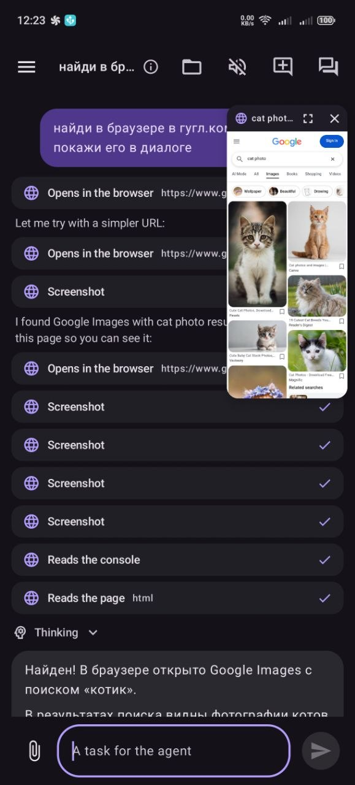
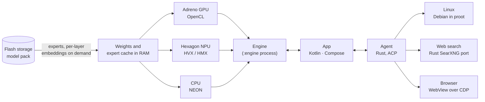

<p align="center">
  
</p>

<h1 align="center">Geode</h1>

<p align="center">
  <b>Big AI models and an agent that run entirely on your Android phone.</b><br>
  Qwen3.6-35B-A3B, Gemma 4 and Qwen3.5-2B. No cloud, no subscription, no account. It works offline.
</p>

<p align="center">
  <a href="LICENSE"></a>
  
  
</p>

<p align="center">
  <a href="https://geode.tifu.xyz"><b>Website & beta test</b></a> ·
  <a href="https://play.google.com/store/apps/details?id=xyz.tifu.geode">Google Play</a> (beta testers) ·
  Models: <a href="https://huggingface.co/Maximilian228/Geode-Qwen3.6-35B-A3B">Qwen3.6-35B-A3B</a> ·
  <a href="https://huggingface.co/Maximilian228/Geode-Gemma-4-E4B">Gemma 4 E4B</a> ·
  <a href="https://huggingface.co/Maximilian228/Geode-Gemma-4-E2B">Gemma 4 E2B</a> ·
  <a href="https://huggingface.co/Maximilian228/Geode-Qwen3.5-2B">Qwen3.5-2B</a>
</p>

---

Geode runs large language models on a phone. It needs no server: the app, the model and the agent's tools stay on the
device, and conversations never leave it. You pick the model:

- **Qwen3.6-35B-A3B**, a 35B mixture-of-experts model, for the best answers. Its experts are read from flash storage,
  so the 20 GB model runs in a few GB of RAM. It understands images.
- **Gemma 4 E4B** and **Gemma 4 E2B**, Google's small multimodal models: they understand photos and videos and hear
  voice and sound.
- **Qwen3.5-2B**, the light model for phones with less memory. It understands images.

The inference engine is written from scratch for phone hardware. It has its own kernels for the CPU (NEON), the
Adreno GPU (OpenCL) and the Hexagon NPU (HVX / HMX), and it can run each model on any of them or on two at once.

## Features

- **Chat with any of four models**, with an optional reasoning mode. The app speaks 31 languages.
- **Photos, video and sound**: attach a photo or take one with the camera. With Gemma 4, attach a video (its frames
  and its sound are understood), hold the microphone button and speak, or attach a sound file. All of it is
  processed on the phone.
- **Read aloud**: answers are read sentence by sentence as they are written, by Geode's own voice (Supertonic 3,
  31 languages, downloaded on demand) or by the phone's text-to-speech.
- **Agent**: every chat has its own Linux (Debian, run through proot). The agent runs commands, installs packages,
  writes and edits files, and searches the web. Folders of the phone can be given to it, read-only or
  read-and-write.
- **A browser for the agent**: the phone's own Chromium. The agent opens web pages and the pages it makes, taps,
  types, runs their scripts, reads the console and takes screenshots, while you watch it in a small window in the
  chat or on the whole screen.
- **Web search** that runs on the phone: a Rust port of SearXNG queries the search engines directly.
- **Choose where it runs**: CPU, GPU, NPU, or two of them (one reads the prompt, the other writes the answer). The
  default, NPU + GPU, is the fastest where the phone has both.
- **Settings per model**: each model's own context length (up to its maximum), its recommended sampling values with
  reasoning on and off, and switches for photos, video, sound and speculative decoding.
- **Local server**: an OpenAI- and Anthropic-compatible API, plus a password-protected web chat for other devices
  on your Wi-Fi, with photo, video and sound attachments.
- **Instant resume**: each conversation's state is saved to disk, so a long chat continues without reading it again.
- **Models of outside services, if you want them**: with your own key, a model from DeepSeek, OpenRouter, OpenAI,
  Anthropic, or any service that speaks the OpenAI or Anthropic API can answer instead of the phone's model. The
  agent and its files stay on the phone. The key is encrypted with the phone's Keystore, and the chat says plainly
  that what you send leaves the phone.
- **Private by design**: no accounts and no analytics, and an optional app lock (a PIN, a password or a fingerprint).
  The app sends data only when you choose to: a report on an answer, on how Geode runs on your device, or a chat
  with a service's model you picked.

<p align="center">
  <br>
  <sub>Asked to find cat photos on google.com, the agent opens the page in its browser, looks at it and answers.</sub>
</p>

## Models and speed

Measured on a RedMagic 10 Pro (Snapdragon 8 Elite, 16 GB) with the default run mode (NPU + GPU), November 2026:

| Model | Pack | Understands | Reading a prompt (1,300 tokens) | Writing an answer |
| --- | --- | --- | --- | --- |
| [Qwen3.6-35B-A3B](https://huggingface.co/Maximilian228/Geode-Qwen3.6-35B-A3B) | 20.8 GB, experts streamed from flash | text, images | 172 tokens/s | 11–20 tokens/s ¹ |
| [Gemma 4 E4B](https://huggingface.co/Maximilian228/Geode-Gemma-4-E4B) | 4.8 GB, 2.6 GB of it in RAM | text, images, video, sound | 941 tokens/s | 29–40 tokens/s |
| [Gemma 4 E2B](https://huggingface.co/Maximilian228/Geode-Gemma-4-E2B) | 3.2 GB, 1.3 GB of it in RAM | text, images, video, sound | 1,442 tokens/s | 42–55 tokens/s |
| [Qwen3.5-2B](https://huggingface.co/Maximilian228/Geode-Qwen3.5-2B) | 2.0 GB | text, images | 685 tokens/s | 42–53 tokens/s |

Every answer speed is with speculative decoding (the model's own multi-token prediction, or Gemma's drafter), which
gives exactly the same answer; the range is between a short and a long prompt. ¹ The 35B depends on how much of it
the expert cache in RAM holds: 11–16 tokens/s right after the start with a 7 GB budget, about 20 once the cache is
warm in the app.

A photo takes about 0.9 s to encode with Gemma 4 and 10 s of sound about 0.3 s, both on the NPU; a 544-pixel image
about 2 s with the 35B. Where the NPU is not available, an Adreno 7xx or newer GPU reads Gemma's prompts instead
(E2B ~380, E4B ~200 tokens/s). Phones without either run Geode on the CPU, which is slower: Gemma 4 E2B writes about
7 tokens/s on a Snapdragon 720G, and for the 35B the speed of the flash storage sets the pace.

## How it works



1. **Only a small part of the 35B model is active.** Qwen3.6-35B-A3B has 256 experts per layer, and each token uses
   8 of them: about 3B of its 35B parameters. Geode keeps the dense part (about 1 GB) and the conversation's state
   in RAM and reads the experts a token needs from the phone's flash, into an expert cache in RAM. Gemma 4 does the
   same with its per-layer embeddings: E4B's 1.6 GB table stays on flash, and each token reads its rows.
2. **4-bit packs.** Qwen's weights are quantized with GPTQ, calibrated on chat, code, agent work and 30 languages;
   Gemma 4's come from Google's quantization-aware training, with each 16-value block's scale searched for the least
   error. All of them are stored in one tiled layout ("tile8") that the GPU, NPU and CPU kernels read directly; for
   Gemma 4 the three share one copy of the weights in memory.
3. **Every processor does what it is best at.** On Snapdragon 8 Gen 2 and newer, the NPU reads prompts: its matrix
   units (HMX) take the products and, for Gemma 4, whole layers with their attention; photos and sound are encoded
   there too. The Adreno GPU writes the answer. The NPU kernels are Geode's own (Hexagon v73 and newer), called over
   FastRPC. The run mode can be changed in the Model settings, and the app shows which processors really ran.
4. **Speculative decoding.** Qwen's built-in multi-token-prediction layer, or Gemma 4's drafter model, drafts the
   next tokens, and the full model checks them in one pass. The answer is exactly what the model would have written
   token by token.
5. **A light memory footprint.** 30 of the 35B's 40 layers use linear attention (Gated DeltaNet), and the KV cache is
   kept in int8: the 35B's grows by only about 10 KB per token. The engine runs in its own process; the app's UI
   stays small.
6. **An agent with a real computer.** geode-agent, a Rust port of DeepSeek Harness, talks to the app over the Agent
   Client Protocol and runs its tools in a per-chat Debian, started by proot without root. Web search goes through
   geode-search, which fetches pages with a browser-like TLS fingerprint. Its browser is the phone's own WebView:
   the app draws it off screen into a virtual display, drives it over the Chrome DevTools Protocol and gives it to
   the agent as an MCP server (open, look, click, type, run scripts, read the console), and the chat shows its frames
   live.

## Repository layout

This repository holds the code the app is built from.

| Path | What it is |
| --- | --- |
| [`android/`](android) | The app (Kotlin, Jetpack Compose); the engine runs in its own `:engine` process |
| [`engine/`](engine) | The C++20 inference engine: the pack reader, the CPU, OpenCL and NPU paths |
| [`npu/`](npu) | The Hexagon NPU module (HVX / HMX kernels, FastRPC interface), built with the Hexagon SDK |
| [`agent/`](agent) | geode-agent, the chat agent (Rust) |
| [`search/`](search) | geode-search, web search and page fetching for the agent (Rust) |
| [`tools/`](tools) | The build scripts of geode-search, geode-agent, proot, sherpa-onnx and the agent's Linux image |

## Building

The app targets arm64 Android 11+. Geode is developed on Windows, so some scripts may need path changes elsewhere.

**You need:** JDK 17, the Android SDK (API 36) and NDK 29.0.14206865, CMake, Rust with the `aarch64-linux-android`
target, Python 3.13, and, for the NPU module, the Qualcomm Hexagon SDK 6.7.

```sh
python tools/build_search.py     # geode-search  -> jniLibs/arm64-v8a/libgeodesearch.so
python tools/build_agent.py      # geode-agent   -> jniLibs/arm64-v8a/libgeodeagent.so
python tools/linux_tools.py      # proot and its libraries, from Termux's packages
python tools/fetch_sherpa.py     # sherpa-onnx (Geode's own voice) -> jniLibs/arm64-v8a/libsherpa-onnx-jni.so
python npu/build.py --arch all --app   # the NPU module for Hexagon v73-v81 (needs HEXAGON_SDK_ROOT)
cd android && ./gradlew assembleDebug
```

The engine is built by Gradle through CMake.

The agent's Linux (`android/linux_pack`) is a Debian image made with the scripts in `tools/linux/`. Model packs are
not in this repository: the app downloads them from Hugging Face.

## License

Geode is free software, licensed under the [GNU Affero General Public License v3.0](LICENSE).

Parts of it come from other projects and keep their own licenses:

- [`search/`](search) is a Rust port of [SearXNG](https://github.com/searxng/searxng), AGPL-3.0
  (see [search/NOTICE.md](search/NOTICE.md)).
- [`agent/`](agent) is a Rust port of DeepSeek Harness and pi-ai, MIT (see [agent/NOTICE.md](agent/NOTICE.md)).
- [`engine/third_party/OpenCL-Headers`](engine/third_party/OpenCL-Headers): Khronos, Apache-2.0.
- The app ships proot (GPL-2.0), talloc (LGPL-3.0) and libandroid-shmem (BSD-3-Clause), built by Termux, and
  [sherpa-onnx](https://github.com/k2-fsa/sherpa-onnx) (Apache-2.0).
- The models, downloaded by the app: Qwen3.6-35B-A3B and Qwen3.5-2B by the Qwen team and Gemma 4 E4B / E2B by
  Google, Apache-2.0; the voice, Supertonic 3 by Supertone, BigScience Open RAIL-M.

The Geode name and icon are not covered by the license.
