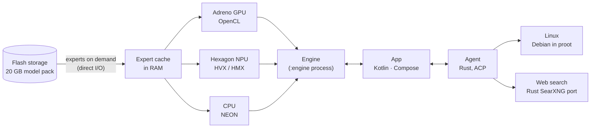

<p align="center">
  
</p>

<h1 align="center">Geode</h1>

<p align="center">
  <b>A 35-billion-parameter AI model and agent that run entirely on your Android phone.</b><br>
  No cloud, no subscription, no account. It works offline.
</p>

<p align="center">
  <a href="LICENSE"></a>
  
  
</p>

<p align="center">
  <a href="https://geode.tifu.xyz"><b>Website & beta test</b></a> ·
  <a href="https://play.google.com/store/apps/details?id=xyz.tifu.geode">Google Play</a> (beta testers) ·
  <a href="https://huggingface.co/Maximilian228/Geode-Qwen3.6-35B-A3B">35B model</a> ·
  <a href="https://huggingface.co/Maximilian228/Geode-Qwen3.5-2B">2B model</a>
</p>

---

Geode runs **Qwen3.6-35B-A3B**, a 35B mixture-of-experts model, on a phone. It needs no server: the app, the model
and the agent's tools stay on the device, and conversations never leave it. A light **Qwen3.5-2B** is there for phones
with less memory.

The inference engine is written from scratch for phone hardware. It has its own kernels for the CPU (NEON), the
Adreno GPU (OpenCL) and the Hexagon NPU (HVX / HMX), and it streams the model's experts from flash storage, so a
20 GB model runs in a few GB of RAM.

## Features

- **Chat with a 35B model**, with an optional reasoning mode. The app speaks 31 languages.
- **Images**: attach a photo and ask about it (the model's own vision tower, also on the device).
- **Agent**: every chat has its own Linux (Debian, run through proot). The agent runs commands, installs packages,
  writes and edits files, and searches the web.
- **Web search** that runs on the phone: a Rust port of SearXNG queries the search engines directly.
- **Local server**: an OpenAI- and Anthropic-compatible API, plus a password-protected web chat for other devices
  on your Wi-Fi.
- **Instant resume**: each conversation's state is saved to disk, so a long chat continues without reading it again.
- **Private by design**: no accounts and no analytics. The app sends data only when you choose to: a report on an
  answer, or on how Geode runs on your device.

## Speed

Measured on a RedMagic 10 Pro (Snapdragon 8 Elite):

| Model | Runs on | Writing an answer | Reading a prompt |
| --- | --- | --- | --- |
| Qwen3.6-35B-A3B (Q4) | GPU + NPU | 20–24 tokens/s | 160–240 tokens/s |
| Qwen3.5-2B (Q4) | NPU only | 33–39 tokens/s | 265–360 tokens/s |

A 544-pixel image takes about 2 seconds to read (35B). Phones older than Snapdragon 8 Gen 2 run Geode on the CPU,
which is slower: there the speed of the flash storage sets the pace.

## How it works



1. **Only a small part of the model is active.** Qwen3.6-35B-A3B has 256 experts per layer, and each token uses 8
   of them: about 3B of its 35B parameters. Geode keeps the dense part (about 1 GB) and the conversation's state in
   RAM and reads the experts a token needs from the phone's flash, into an expert cache in RAM.
2. **One 4-bit pack.** Weights are quantized with GPTQ, calibrated on chat, code, agent work and 30 languages, and
   stored as 4-bit values with FP8 block scales in a tiled layout ("tile8") that the GPU, NPU and CPU kernels all
   read directly. Measured against the original BF16 model, the same top token is chosen 91% of the time.
3. **Every processor does what it is best at.** On Snapdragon 8 Elite, the GPU writes the 35B model's answers while
   the NPU reads prompts beside it: its matrix units take the projections and a share of the experts. The 2B model
   runs entirely on the NPU. The NPU kernels are Geode's own (Hexagon v73 and newer), called over FastRPC.
4. **Speculative decoding.** The model's built-in multi-token-prediction layer drafts the next tokens, and the
   full model checks them in one pass. The answer is exactly what the model would have written token by token.
5. **A light memory footprint.** 30 of the 40 layers use linear attention (Gated DeltaNet), and the KV cache of the
   other 10 is kept in int8: it grows by only about 10 KB per token. The engine runs in its own process; the app's UI stays small.
6. **An agent with a real computer.** geode-agent, a Rust port of DeepSeek Harness, talks to the app over the Agent
   Client Protocol and runs its tools in a per-chat Debian, started by proot without root. Web search goes through
   geode-search, which fetches pages with a browser-like TLS fingerprint.

## Repository layout

This repository holds the code the app is built from.

| Path | What it is |
| --- | --- |
| [`android/`](android) | The app (Kotlin, Jetpack Compose); the engine runs in its own `:engine` process |
| [`engine/`](engine) | The C++20 inference engine: the pack reader, the CPU, OpenCL and NPU paths |
| [`npu/`](npu) | The Hexagon NPU module (HVX / HMX kernels, FastRPC interface), built with the Hexagon SDK |
| [`agent/`](agent) | geode-agent, the chat agent (Rust) |
| [`search/`](search) | geode-search, web search and page fetching for the agent (Rust) |
| [`tools/`](tools) | The build scripts of geode-search, geode-agent, proot and the agent's Linux image |

## Building

The app targets arm64 Android 11+. Geode is developed on Windows, so some scripts may need path changes elsewhere.

**You need:** JDK 17, the Android SDK (API 36) and NDK 29.0.14206865, CMake, Rust with the `aarch64-linux-android`
target, Python 3.13, and, for the NPU module, the Qualcomm Hexagon SDK 6.7.

```sh
python tools/build_search.py     # geode-search  -> jniLibs/arm64-v8a/libgeodesearch.so
python tools/build_agent.py      # geode-agent   -> jniLibs/arm64-v8a/libgeodeagent.so
python tools/linux_tools.py      # proot and its libraries, from Termux's packages
python npu/build.py --app        # the NPU module (needs HEXAGON_SDK_ROOT)
cd android && ./gradlew assembleDebug
```

The engine is built by Gradle through CMake.

The agent's Linux (`android/linux_pack`) is a Debian image made with the scripts in `tools/linux/`. Model packs are
not in this repository: the app downloads them from Hugging Face.

## License

Geode is free software, licensed under the [GNU Affero General Public License v3.0](LICENSE).

Parts of it come from other projects and keep their own licenses:

- [`search/`](search) is a Rust port of [SearXNG](https://github.com/searxng/searxng), AGPL-3.0
  (see [search/NOTICE.md](search/NOTICE.md)).
- [`agent/`](agent) is a Rust port of DeepSeek Harness and pi-ai, MIT (see [agent/NOTICE.md](agent/NOTICE.md)).
- [`engine/third_party/OpenCL-Headers`](engine/third_party/OpenCL-Headers): Khronos, Apache-2.0.
- The app ships proot (GPL-2.0), talloc (LGPL-3.0) and libandroid-shmem (BSD-3-Clause), built by Termux.
- The models are Qwen3.6-35B-A3B and Qwen3.5-2B by the Qwen team, Apache-2.0.

The Geode name and icon are not covered by the license.
