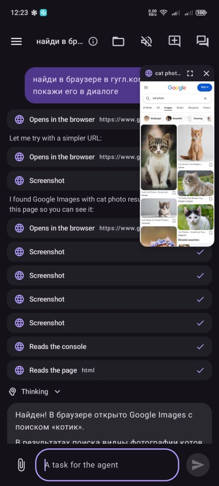
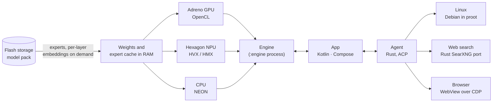

<p align="center">
  
</p>

<h1 align="center">Geode</h1>

<p align="center">
  <b>Big AI models, an agent, a voice, a songwriter and an image generator that run entirely on your Android phone.</b><br>
  Qwen3.6-35B-A3B, Gemma 4, Qwen3.5-2B and six more models, speech in 31 languages, YuE2 and ACE-Step songs and
  FLUX.2 klein images. No cloud, no subscription, no account. It works offline.
</p>

<p align="center">
  <a href="https://play.google.com/store/apps/details?id=xyz.tifu.geode"></a>
</p>

<p align="center">
  <a href="LICENSE"></a>
  
</p>

<p align="center">
  <a href="https://geode.tifu.xyz"><b>Website</b></a> ·
  <a href="https://play.google.com/store/apps/details?id=xyz.tifu.geode">Google Play</a> ·
  <a href="https://geode.tifu.xyz/board"><b>Speed table</b></a> ·
  Models: <a href="https://huggingface.co/Maximilian228/Geode-Qwen3.6-35B-A3B">Qwen3.6-35B-A3B</a> ·
  <a href="https://huggingface.co/Maximilian228/Geode-Gemma-4-E4B">Gemma 4 E4B</a> ·
  <a href="https://huggingface.co/Maximilian228/Geode-Gemma-4-E2B">Gemma 4 E2B</a> ·
  <a href="https://huggingface.co/Maximilian228/Geode-Qwen3.5-2B">Qwen3.5-2B</a> ·
  <a href="https://huggingface.co/Maximilian228/Geode-Qwen3.8-Flash-Next">Qwen3.8-Flash-Next</a> ·
  <a href="https://huggingface.co/Maximilian228/Geode-LFM3-1.7B">LFM3-1.7B</a> ·
  Ternary Bonsai 2 <a href="https://huggingface.co/Maximilian228/Geode-Ternary-Bonsai-2-2B">2B</a> /
  <a href="https://huggingface.co/Maximilian228/Geode-Ternary-Bonsai-2-4B">4B</a> /
  <a href="https://huggingface.co/Maximilian228/Geode-Ternary-Bonsai-2-9B">9B</a> ·
  <a href="https://huggingface.co/Maximilian228/Geode-YuE2">YuE2 (songs)</a> ·
  <a href="https://huggingface.co/Maximilian228/Geode-ACE-Step-1.5">ACE-Step 1.5 (songs)</a> ·
  <a href="https://huggingface.co/Maximilian228/Geode-FLUX.2-klein-4B">FLUX.2 klein 4B (images)</a> ·
  <a href="https://huggingface.co/Maximilian228/Geode-Supertonic-3">Supertonic 3 (voice)</a> ·
  <a href="https://huggingface.co/Maximilian228/Geode-STT-parakeet-uk-ru-en">Parakeet uk-ru-en (speech recognition)</a>
</p>

---

Geode runs large language models on a phone. It needs no server: the app, the model and the agent's tools stay on the
device, and conversations never leave it. You pick the model:

- **Qwen3.6-35B-A3B**, a 35B mixture-of-experts model, for the best answers. Its experts are read from flash storage,
  so the 20 GB model runs in a few GB of RAM. It understands images.
- **Gemma 4 E4B** and **Gemma 4 E2B**, Google's small multimodal models: they understand photos and videos and hear
  voice and sound.
- **Qwen3.5-2B**, the light model for phones with less memory. It understands images.
- **LFM3-1.7B** by Liquid AI, a small text model that reads long prompts very fast on the NPU, and **Ternary Bonsai
  2** (2B, 4B, 9B) by PrismML, Qwen3.5 models with ternary weights: the 9B in a 3.3 GB pack.
- **Qwen3.8-Flash-Next**, the largest: a mixture of experts for phones with 12 GB of RAM or more and about 100 GB of
  free storage, read from flash a few experts at a time. It is slow on a phone (about 3 tokens/s), there for the
  biggest phones.

The inference engine is written from scratch for phone hardware. It has its own kernels for the CPU (NEON), the
Adreno GPU (OpenCL) and the Hexagon NPU (HVX / HMX), and it can run each model on any of them or on two at once.

## Features

- **Chat with any of nine models**, with an optional reasoning mode. Roll a chat back to an earlier message, edit
  your question, or get another answer. The app speaks 31 languages.
- **Model updates and add-ons**: the *Update* button downloads only the files of a model that changed; when the phone
  has no room for the old and the new files together, the model updates in place, a file at a time, and an
  interrupted update continues where it stopped. Photo analysis, sound analysis and *Fewer refusals* (off by
  default) are optional add-ons: download a model without them and add them later; switched off, they use no memory.
- **A public speed table** at [geode.tifu.xyz/board](https://geode.tifu.xyz/board): how fast each model runs on each
  phone, measured by Geode's own engine. See [Speed table](#speed-table).
- **Photos, video and sound**: attach a photo or take one with the camera. With Gemma 4, attach a video (its frames
  and its sound are understood), hold the microphone button and speak, or attach a sound file. All of it is
  processed on the phone.
- **Voice**: speak instead of typing, talk hands-free (a pause sends what you said, the answer is read aloud, then
  Geode listens again), and hear answers read sentence by sentence as they are written - in the app's 31 languages,
  offline. Geode's own Parakeet fine-tune recognizes Ukrainian, Russian and English; the voices and recognizers are
  downloaded on demand, picked from a list with search. See [Voice](#voice).
- **Songs**: a whole song from your lyrics and a style, in any language - the score, the voice and the band made on
  the phone by YuE2-3B - then edited bar by bar: cut, sing a part again, new words, go on, move a section, put in a
  break. Or an instrumental with a plan of sections. Or ACE-Step 1.5 (MIT: songs you may use commercially), also
  from an idea that the chat's model turns into lyrics and a style. See [Songs](#songs).
- **Images**: a picture from a few words, drawn on the phone by FLUX.2 [klein] 4B, with a live preview after each
  step - or a photo edited with up to four reference images. Batches, seeds you can repeat, prompt variations, six
  aspect ratios in three sizes. See [Images](#images).
- **Agent**: every chat has its own Linux (Debian, run through proot). The agent runs commands, installs packages,
  writes and edits files, and searches the web. Ask the chat for a picture or a song and the agent makes it (two
  skills you can switch off; the chat's model steps aside while the image or song model works). It answers in the phone's language unless you change that in the
  Agent settings. Folders of the phone can be given to it, read-only or read-and-write.
- **A browser for the agent**: the phone's own Chromium. The agent opens web pages and the pages it makes, taps,
  types, runs their scripts, reads the console and takes screenshots, while you watch it in a small window in the
  chat or on the whole screen.
- **Web search** that runs on the phone: a Rust port of SearXNG queries the search engines directly.
- **Choose where it runs**: CPU, GPU, NPU, or two of them (one reads the prompt, the other writes the answer). The
  default, NPU + GPU, is the fastest where the phone has both.
- **Settings per model**: each model's own context length (up to its maximum), its recommended sampling values with
  reasoning on and off, and switches for photos, video, sound and speculative decoding.
- **Local server**: an OpenAI- and Anthropic-compatible API, plus a password-protected web chat for other devices
  on your Wi-Fi, with photo, video and sound attachments.
- **Instant resume**: each conversation's state is saved to disk, so a long chat continues without reading it again.
- **Models of outside services, if you want them**: with your own key, a model from DeepSeek, OpenRouter, OpenAI,
  Anthropic, or any service that speaks the OpenAI or Anthropic API can answer instead of the phone's model. The
  agent and its files stay on the phone. The key is encrypted with the phone's Keystore, and the chat says plainly
  that what you send leaves the phone.
- **Private by design**: no accounts and no analytics, and an optional app lock (a PIN, a password or a fingerprint).
  The app sends data only when you choose to: a report on an answer, on how Geode runs on your device, or a chat
  with a service's model you picked.

<p align="center">
  <br>
  <sub>Asked to find cat photos on google.com, the agent opens the page in its browser, looks at it and answers.</sub>
</p>

## Models and speed

Measured on a RedMagic 10 Pro (Snapdragon 8 Elite, 16 GB) with the default run mode (NPU + GPU), November 2026:

| Model | Pack | Understands | Reading a prompt (1,300 tokens) | Writing an answer |
| --- | --- | --- | --- | --- |
| [Qwen3.6-35B-A3B](https://huggingface.co/Maximilian228/Geode-Qwen3.6-35B-A3B) | 20.8 GB, experts streamed from flash | text, images | 172 tokens/s | 11–20 tokens/s ¹ |
| [Gemma 4 E4B](https://huggingface.co/Maximilian228/Geode-Gemma-4-E4B) | 4.8 GB, 2.6 GB of it in RAM | text, images, video, sound | 941 tokens/s | 29–40 tokens/s |
| [Gemma 4 E2B](https://huggingface.co/Maximilian228/Geode-Gemma-4-E2B) | 3.2 GB, 1.3 GB of it in RAM | text, images, video, sound | 1,442 tokens/s | 42–55 tokens/s |
| [Qwen3.5-2B](https://huggingface.co/Maximilian228/Geode-Qwen3.5-2B) | 2.0 GB | text, images | 685 tokens/s | 42–53 tokens/s |

Every answer speed is with speculative decoding (the model's own multi-token prediction, or Gemma's drafter), which
gives exactly the same answer; the range is between a short and a long prompt. ¹ The 35B depends on how much of it
the expert cache in RAM holds: 11–16 tokens/s right after the start with a 7 GB budget, about 20 once the cache is
warm in the app.

A photo takes about 0.9 s to encode with Gemma 4 and 10 s of sound about 0.3 s, both on the NPU; a 544-pixel image
about 2 s with the 35B. Where the NPU is not available, an Adreno 7xx or newer GPU reads Gemma's prompts instead
(E2B ~380, E4B ~200 tokens/s). Phones without either run Geode on the CPU, which is slower: Gemma 4 E2B writes about
7 tokens/s on a Snapdragon 720G, and for the 35B the speed of the flash storage sets the pace.

LFM3-1.7B, Ternary Bonsai 2 and Qwen3.8-Flash-Next: their speeds are on their model cards
([LFM3-1.7B](https://huggingface.co/Maximilian228/Geode-LFM3-1.7B),
[Bonsai 2 2B](https://huggingface.co/Maximilian228/Geode-Ternary-Bonsai-2-2B),
[4B](https://huggingface.co/Maximilian228/Geode-Ternary-Bonsai-2-4B),
[9B](https://huggingface.co/Maximilian228/Geode-Ternary-Bonsai-2-9B),
[Qwen3.8-Flash-Next](https://huggingface.co/Maximilian228/Geode-Qwen3.8-Flash-Next)).

## Speed table

[geode.tifu.xyz/board](https://geode.tifu.xyz/board) is a public table of how fast Geode's models run on real phones.
It is new and still empty: the app's *Speed & ranking* screen and its *Publish these results in the public table*
checkbox arrive with the next app update.

- **Measured on the phone.** Geode's own engine runs synthetic packs of the real models' sizes in every run mode;
  where a case did not run, its speed is estimated from the phone's own test results and marked as an estimate.
- **Each unit apart**: the CPU, the GPU, the NPU and (on MediaTek / Exynos) the APU, each shown as running the model,
  running part of it, or running nothing of it (then an estimate in theory).
- **Ranked per phone**: phones are grouped by model, chip and RAM size, so a 12 GB and a 16 GB version of a phone are
  separate groups.
- **Opt-in only**: a phone appears only when its owner ticks the box, with the phone's model, chips, test numbers
  and estimates under its report number - no IP address, account or settings. Unticking it takes the record back.
- **The app version** each row was measured with is shown, with a filter by version.

## Songs

Geode writes and sings songs with [YuE2-3B](https://huggingface.co/m-a-p/YuE2-3B) by m-a-p, on its own engine. The
model first writes the song's score (ABC notation: the melody and the chords), then the sound's codes, 25 a second;
a flow-matching stage and YuE2's decoder turn them into 48 kHz stereo, mastered to -12.5 LUFS. The settings are the
reference's (32 steps, the full score first). On a RedMagic 10 Pro a 30-second song takes about 1.5 minutes: the
prompts and the sound on the NPU, the decoder on the GPU, the score and the codes on the CPU. Phones without a usable
NPU make songs too, more slowly (the sound on the Adreno GPU).

- **Lyrics and style**: style presets, pickers for the language, genre, voice and instruments, and a lyrics editor
  that knows what the model reads - section tags, a pause, the stress of a word (its stressed vowel in capitals).
  A lyrics writer drafts the words with the chat's model. Any language works, Ukrainian included.
- **Takes and scores**: up to four takes at once (composed together, the weights read once for all of them), or
  "scores first": only the tunes written, heard as MIDI, and the one you like sung. A score can come from a MIDI file,
  be moved to another key, edited as text, or in a piano roll.
- **Edit the track**: the bars are laid over the waveform from the song's own score. Cut bars out, sing a part
  again, give it new words on the same tune, let the song go on, move a whole section, or put in an instrumental
  break (experimental). Only the stretch an edit touches is made again and crossfaded in; the rest of the song stays
  the same, sample for sample. The methods follow [YuE2-ComfyUI](https://github.com/pytraveler/YuE2-ComfyUI)'s
  inpainting.
- **Instrumentals**: with Mothersuperior's
  [instrumental adapter](https://huggingface.co/Mothersuperior/YuE2-instrumental-cot-full-loras) (a LoRA, 139 MB,
  downloaded on demand) the model writes music without a voice, with a plan of sections you give or leave to it. The
  phone merges the adapter into a copy of the model's weights the first time it is used - on a phone with the NPU
  into the NPU's fp16 layers as well, so an instrumental keeps the sound's prompt on the NPU (2 s instead of 40).
- **From other devices**: the local server makes songs too (`/v1/music/...` and a Music page in the web chat).

YuE2 and the adapter are licensed CC BY-NC 4.0: the songs are for non-commercial use.

### ACE-Step 1.5

[ACE-Step 1.5](https://github.com/ace-step/ACE-Step-1.5) by ACE Studio and StepFun is MIT-licensed: its songs may be
used commercially. Geode has it as two models: **ACE-Step 1.5** (the sft model, 50 steps with guidance, the best
sound, the default) and **ACE-Step 1.5 turbo** (8 steps, several times faster). A 1.7B planner writes the song's
plan and audio codes, a diffusion transformer makes the sound and a VAE decodes it to 48 kHz stereo; each stage can
run on the CPU, the GPU or the NPU. Lyrics can be in any language, or the chat's model writes the lyrics and the
style from your idea. On a RedMagic 10 Pro (Snapdragon 8 Elite, auto mode) a 30-second song took about 50 s with
turbo and about 78 s with sft.

## Images

Geode draws pictures with [FLUX.2 [klein] 4B](https://huggingface.co/black-forest-labs/FLUX.2-klein-4B) by Black
Forest Labs, on its own engine. The model is distilled to four steps without guidance: the Qwen3-4B text encoder reads
the prompt, the 3.9B transformer draws in four steps, and the VAE turns the result into pixels. The three stages run
one after another, each loaded and freed in turn, so only the largest one is ever in memory. The pipeline follows
diffusers' `Flux2KleinPipeline` (its scheduler and its noise for a seed), so a seed gives the original's picture.

On a RedMagic 10 Pro (Snapdragon 8 Elite) a 512 x 512 image takes about 11-12 s from the prompt to the picture, all
three stages on the NPU (HMX), the default there; about 23 s with one reference image to edit, and about 94 s with
everything on the CPU (the int8 pack). A phone without an NPU uses its Adreno 7xx or newer (or Mali) GPU, else the
CPU; on the Redmi Note 9 Pro (Snapdragon 720G, 6 GB) the Hexagon DSP shares the transformer's products with the CPU,
and a 256 x 256 image takes 2.5-10 minutes in the app, depending on how warm the phone is.

- **Text to image**: Small (512 x 512 for a square), Medium and Large (about 1 megapixel; it needs a memory budget
  of 6 GB) sizes in six aspect ratios, portrait or landscape, or a size of your own. A live preview shows the image
  forming after each step (TAEF2, off the critical path).
- **Edit**: add up to four reference images - photos, the camera, or earlier results - and say in the prompt what to
  change ("image 1", "image 2"... are the references). The VAE's encoder reads them; the same model does the edit.
- **Batches and seeds**: up to 16 images at a time, the same prompt or one prompt per image, with the seeds
  incremented, randomized or fixed. Prompts can vary per image (`{a|b}`, weights, your own word lists), and every
  result keeps its seed and its expanded prompt, so "Reuse settings" makes it again.
- **Where it runs**: Auto (the NPU, then the GPU, then the CPU), or CPU, GPU or NPU by hand. The app shows which
  unit drew each stage.
- **Opt-ins, off by default**: a fast mode (shorter text padding, about 30% less drawing time, a different sample)
  and BFL's small decoder (faster decoding, slightly different fine detail).
- **From other devices**: the local server makes images too - OpenAI's `/v1/images/generations` and
  `/v1/images/edits`, Geode's own queued jobs at `/v1/images/jobs`, and an Images page in the web chat.

| Pack | Transformer | Download | Against the original (fp32, 512²) |
| --- | --- | --- | --- |
| [fp16](https://huggingface.co/Maximilian228/Geode-FLUX.2-klein-4B) (default) | fp16, 7.2 GiB | 10.2 GB | the same image (76 dB PSNR) |
| [int8](https://huggingface.co/Maximilian228/Geode-FLUX.2-klein-4B) (opt-in) | int8 with a Hadamard turn, 4.0 GiB | 6.7 GB | the same picture, finer detail differing (30-41 dB) |

Both packs share the 4-bit text encoder and the fp16 VAE. A phone whose memory cannot hold the transformer reads its
blocks from flash at every step instead, so 6 GB phones make images too, more slowly. FLUX.2 [klein] 4B is
Apache-2.0. Each PNG carries its prompt and settings, and every image has a "Report this image" button.

## Voice

Geode listens and speaks on the phone, with no server: speech input in the chat, a hands-free conversation ("Always
listening": you talk, a pause sends it, the answer is read aloud, then it listens again - never while Geode speaks),
and answers read aloud sentence by sentence while they are written. The app's 31 languages are covered; a voice for
Hausa is not there yet, and its speech is recognized but not read. The phone's own text-to-speech can be turned on as
an opt-in for the languages the picked voice does not read.

- **Picking a model**: a picker with search (a name, a language or a code) and the recommended model for the app's
  language on top; one tap selects it and downloads it if it is not on the phone. Only the picked model is downloaded
  and kept in memory, and only while it works. The recognizer recommended for a language is computed from its
  measured error rate and speed, never written by hand.
- **Runs on, per model**: speech output and speech input each have their own "Runs on" with the modes the engine
  really runs on this phone, each with its memory: CPU, GPU, or both, and NPU + CPU for Parakeet where the phone's
  DSP is usable. Auto takes the mode measured fastest.
- **Geode's own voice engine**: Supertonic 3, Ava (Kokoro) Persian, MeloTTS Chinese and Mimic 3 Swahili run on
  Geode's own int8 kernels instead of sherpa-onnx, on both newer (i8mm) and older (dotprod) phones: faster and with
  less memory, for example Supertonic on a Snapdragon 8 Elite at 0.19 s of work per second of speech against
  sherpa-onnx's 0.32. Parakeet runs on the engine too (the FastConformer encoder on the CPU, GPU or the DSP's HVX,
  the error rate within 0.1 point of sherpa-onnx's on FLEURS).
- **ZONOS3 on the NPU**: on a phone with a modern NPU (Snapdragon 8 Elite) ZONOS3's codec runs on the DSP, the
  fastest mode; "NPU only" moves its language model there too and uses about 31% less energy per second of speech
  (2.6 J against 3.8 J, measured unplugged on the RedMagic), a little slower.

| Speech output (voices) | Languages | Licence |
| --- | --- | --- |
| [Supertonic 3](https://huggingface.co/Maximilian228/Geode-Supertonic-3) by Supertone | 31, Ukrainian, Russian and English among them (Javanese read as Indonesian) | BigScience Open RAIL-M |
| [Indic Tiny](https://huggingface.co/Maximilian228/Geode-TTS-Indic) (sherpa Matcha, Vocos vocoder) | Bengali, Gujarati, Kannada, Marathi, Punjabi, Tamil, Telugu | CC-BY-4.0 + MIT |
| [MeloTTS](https://huggingface.co/Maximilian228/Geode-TTS-Melo-zh) by MyShell.ai | Chinese (with English) | MIT |
| [Mimic 3](https://huggingface.co/Maximilian228/Geode-TTS-sw) by Mycroft AI | Swahili | CC-BY-SA-4.0 |
| [Ava](https://huggingface.co/Maximilian228/Geode-TTS-fa) (a Kokoro-82M fine-tune) | Persian | Apache-2.0 |
| [ZONOS3-Mini](https://huggingface.co/Maximilian228/Geode-TTS-ZONOS3) by Zyphra | Thai, Filipino, Urdu, Chinese | Apache-2.0 |

| Speech input (recognizers) | Languages | Licence |
| --- | --- | --- |
| [Parakeet TDT 0.6B uk-ru-en](https://huggingface.co/Maximilian228/Geode-STT-parakeet-uk-ru-en) (Geode's fine-tune), [Parakeet uk](https://huggingface.co/Maximilian228/Geode-STT-parakeet-uk), [Parakeet v3](https://huggingface.co/Maximilian228/Geode-STT-parakeet-v3) | Ukrainian, Russian, English; v3: 25 European languages | CC-BY-4.0 |
| [Whisper large-v3 turbo](https://huggingface.co/Maximilian228/Geode-STT-whisper-turbo) and its [Ukrainian](https://huggingface.co/Maximilian228/Geode-STT-whisper-turbo-uk), [Persian](https://huggingface.co/Maximilian228/Geode-STT-whisper-turbo-fa) and [Thai](https://huggingface.co/Maximilian228/Geode-STT-whisper-th) fine-tunes | multilingual | MIT; fa CC-BY-4.0; th Apache-2.0 |
| [SenseVoice Small](https://huggingface.co/Maximilian228/Geode-STT-sensevoice) | Chinese, English, Japanese, Korean | FunASR Model License 1.1 |
| [Omnilingual ASR 1B](https://huggingface.co/Maximilian228/Geode-STT-omnilingual-1b) by Meta | Swahili, Hausa, Javanese, Filipino and more | Apache-2.0 |
| [IndicConformer 600M](https://huggingface.co/Maximilian228/Geode-STT-indicconformer) by AI4Bharat | Hindi, Bengali, Tamil, Telugu, Marathi, Gujarati, Kannada, Punjabi, Urdu | MIT |

Everything runs offline once downloaded; nothing you say leaves the phone.

## How it works



1. **Only a small part of the 35B model is active.** Qwen3.6-35B-A3B has 256 experts per layer, and each token uses
   8 of them: about 3B of its 35B parameters. Geode keeps the dense part (about 1 GB) and the conversation's state
   in RAM and reads the experts a token needs from the phone's flash, into an expert cache in RAM. Gemma 4 does the
   same with its per-layer embeddings: E4B's 1.6 GB table stays on flash, and each token reads its rows.
2. **4-bit packs.** Qwen's weights are quantized with GPTQ, calibrated on chat, code, agent work and 30 languages;
   Gemma 4's come from Google's quantization-aware training, with each 16-value block's scale searched for the least
   error. All of them are stored in one tiled layout ("tile8") that the GPU, NPU and CPU kernels read directly; for
   Gemma 4 the three share one copy of the weights in memory.
3. **Every processor does what it is best at.** On Snapdragon 8 Gen 2 and newer, the NPU reads prompts: its matrix
   units (HMX) take the products and, for Gemma 4, whole layers with their attention; photos and sound are encoded
   there too. The Adreno GPU writes the answer. The NPU kernels are Geode's own (Hexagon v73 and newer), called over
   FastRPC. The run mode can be changed in the Model settings, and the app shows which processors really ran.
4. **Speculative decoding.** Qwen's built-in multi-token-prediction layer, or Gemma 4's drafter model, drafts the
   next tokens, and the full model checks them in one pass. The answer is exactly what the model would have written
   token by token.
5. **A light memory footprint.** 30 of the 35B's 40 layers use linear attention (Gated DeltaNet), and the KV cache is
   kept in int8: the 35B's grows by only about 10 KB per token. The engine runs in its own process; the app's UI
   stays small.
6. **An agent with a real computer.** geode-agent, a Rust port of DeepSeek Harness, talks to the app over the Agent
   Client Protocol and runs its tools in a per-chat Debian, started by proot without root. Web search goes through
   geode-search, which fetches pages with a browser-like TLS fingerprint. Its browser is the phone's own WebView:
   the app draws it off screen into a virtual display, drives it over the Chrome DevTools Protocol and gives it to
   the agent as an MCP server (open, look, click, type, run scripts, read the console), and the chat shows its frames
   live.

## Repository layout

This repository holds the code the app is built from.

| Path | What it is |
| --- | --- |
| [`android/`](android) | The app (Kotlin, Jetpack Compose); the engine runs in its own `:engine` process |
| [`engine/`](engine) | The C++20 inference engine: the pack reader, the CPU, OpenCL and NPU paths, and the song engine (YuE2: the score and codes, the sound, the decoder, the track edits) |
| [`npu/`](npu) | The Hexagon NPU module (HVX / HMX kernels, FastRPC interface), built with the Hexagon SDK |
| [`agent/`](agent) | geode-agent, the chat agent (Rust) |
| [`search/`](search) | geode-search, web search and page fetching for the agent (Rust) |
| [`tools/`](tools) | The build scripts of geode-search, geode-agent, proot, sherpa-onnx and the agent's Linux image |

## Building

The app targets arm64 Android 11+. Geode is developed on Windows, so some scripts may need path changes elsewhere.

**You need:** JDK 17, the Android SDK (API 36) and NDK 29.0.14206865, CMake, Rust with the `aarch64-linux-android`
target, Python 3.13, and, for the NPU module, the Qualcomm Hexagon SDK 6.7.

```sh
python tools/build_search.py     # geode-search  -> jniLibs/arm64-v8a/libgeodesearch.so
python tools/build_agent.py      # geode-agent   -> jniLibs/arm64-v8a/libgeodeagent.so
python tools/linux_tools.py      # proot and its libraries, from Termux's packages
python tools/fetch_sherpa.py     # sherpa-onnx (Geode's own voice) -> jniLibs/arm64-v8a/libsherpa-onnx-jni.so
python npu/build.py --arch all --app   # the NPU module for Hexagon v73-v81 (needs HEXAGON_SDK_ROOT)
cd android && ./gradlew assembleDebug
```

The engine is built by Gradle through CMake.

The agent's Linux (`android/linux_pack`) is a Debian image made with the scripts in `tools/linux/`. Model packs are
not in this repository: the app downloads them from Hugging Face.

## License

Geode is free software, licensed under the [GNU Affero General Public License v3.0](LICENSE).

Parts of it come from other projects and keep their own licenses:

- [`search/`](search) is a Rust port of [SearXNG](https://github.com/searxng/searxng), AGPL-3.0
  (see [search/NOTICE.md](search/NOTICE.md)).
- [`agent/`](agent) is a Rust port of DeepSeek Harness and pi-ai, MIT (see [agent/NOTICE.md](agent/NOTICE.md)).
- [`engine/third_party/OpenCL-Headers`](engine/third_party/OpenCL-Headers): Khronos, Apache-2.0.
- The app ships proot (GPL-2.0), talloc (LGPL-3.0) and libandroid-shmem (BSD-3-Clause), built by Termux, and
  [sherpa-onnx](https://github.com/k2-fsa/sherpa-onnx) (Apache-2.0).
- The models, downloaded by the app: Qwen3.6-35B-A3B and Qwen3.5-2B by the Qwen team and Gemma 4 E4B / E2B by
  Google, Apache-2.0; the voices and recognizers, each under its own licence (see [Voice](#voice)); the song model, YuE2-3B and
  YuE2-Vae by m-a-p, and the instrumental adapter by Mothersuperior, CC BY-NC 4.0; ACE-Step 1.5 by ACE Studio and
  StepFun, MIT; LFM3-1.7B by Liquid AI, LFM Open License v1.0; Ternary Bonsai 2 by PrismML, Apache-2.0;
  Qwen3.8-Flash-Next by the Qwen team, Qwen Community License 1.0; the image model, FLUX.2 [klein]
  4B and its small decoder by Black Forest Labs, Apache-2.0, with TAEF2 by Ollin Boer Bohan (MIT) for the previews.
- The score tools and the track edits port parts of [YuE2-ComfyUI](https://github.com/pytraveler/YuE2-ComfyUI)
  (Apache-2.0) and YuE's `abc_tools.py` (Apache-2.0).

The Geode name and icon are not covered by the license.
